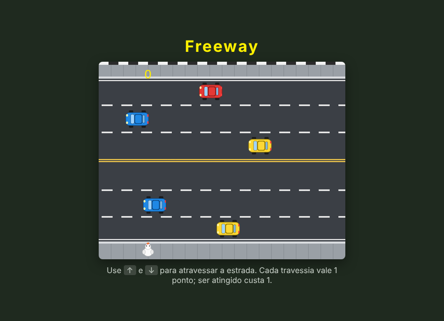

# Freeway

[](https://github.com/almircs/Freeway/actions/workflows/ci.yml)

Jogo em que você leva a galinha de um lado ao outro de uma estrada de seis faixas sem ser atropelada. Feito em JavaScript com a biblioteca [p5.js](https://p5js.org/), no curso de lógica de programação da Alura, inspirado no clássico do Atari.

**[▶ Jogar agora](https://almircs.github.io/Freeway/)**



## Como jogar

- Pressione uma tecla ou clique para começar (a trilha sonora começa junto)
- `↑` e `↓` movem a galinha
- Chegar ao outro lado vale **1 ponto**; ser atingido volta ao início e tira **1 ponto**

## Como o código está organizado

| Arquivo | Responsabilidade |
|---|---|
| `sketch.js` | `setup` e `draw` do p5.js, tela inicial e início do áudio |
| `ator.js` | movimento da galinha, colisões e placar |
| `carro.js` | posição, velocidade e retorno dos carros |
| `imagens.js` | carregamento de imagens e sons |
| `p5.collide2d.js` | biblioteca de detecção de colisão |

## Rodar localmente

Como o jogo carrega imagens e sons, ele precisa ser aberto por um servidor local:

```bash
git clone https://github.com/almircs/Freeway.git
cd Freeway
python3 -m http.server
```

Depois acesse `http://localhost:8000`.

## Licença

[MIT](LICENSE)
